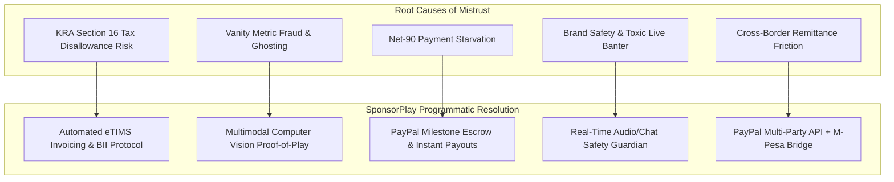
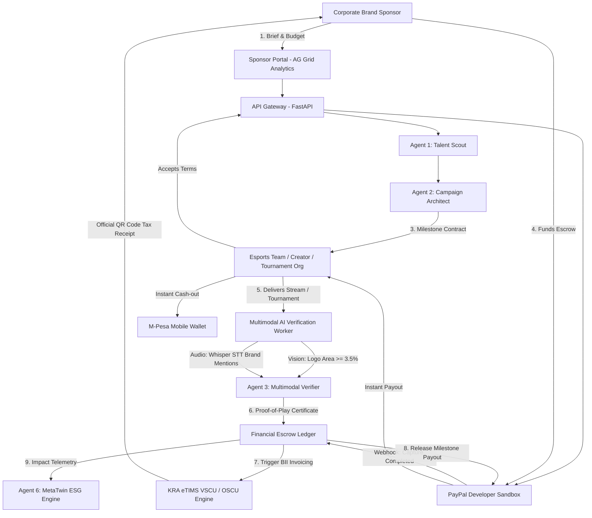
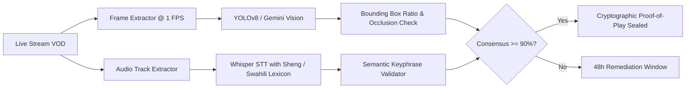
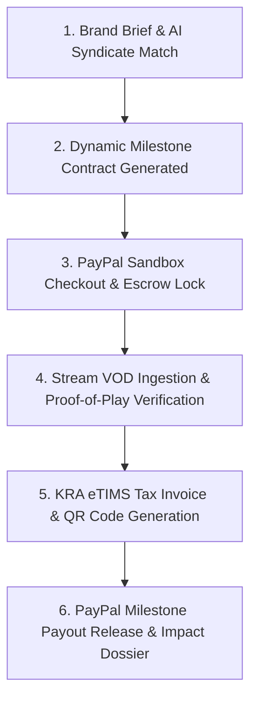

# BARBAH SPONSORPLAY: Master Systems Architecture & Venture Strategy Blueprint
**Platform:** Barbah SponsorPlay  
**Hackathon Track:** PayPal Global Hackathon — Challenge 02: Sponsor Play  
**Ecosystem:** BARBAH PlayEconomy (SponsorPlay, Coach2Earn, ArenaPay, Play2Pro)  
**Location:** Nairobi, Kenya  
**Role:** Solutions Architect & Systems Engineering Lead  
**Status:** Complete Architectural Specification & Pre-Build Strategy  

---

## Table of Contents
1. [Executive Master Summary](#1-executive-master-summary)
2. [The Core Innovation: Agentic AI Swarm](#2-the-core-innovation-agentic-ai-swarm)
3. [The Financial & Tax Masterstroke: PayPal + KRA eTIMS Dual-Rail](#3-the-financial--tax-masterstroke-paypal--kra-etims-dual-rail)
4. [Deep Stakeholder Empathy & Mistrust Resolution](#4-deep-stakeholder-empathy--mistrust-resolution)
5. [Industry Case Studies & Strategic Post-Mortems](#5-industry-case-studies--strategic-post-mortems)
6. [Complete Systems Architecture & Visual Diagrams](#6-complete-systems-architecture--visual-diagrams)
7. [Cutting-Edge Innovation Opportunities & Suggested Technologies](#7-cutting-edge-innovation-opportunities--suggested-technologies)
8. [Venture Strategy: From Hackathon Winner to Venture-Backed Startup](#8-venture-strategy-from-hackathon-winner-to-venture-backed-startup)
9. [Pre-Build Implementation Roadmap & Hackathon MVP Scope](#9-pre-build-implementation-roadmap--hackathon-mvp-scope)
10. [Master Repository Documentation Map](#10-master-repository-documentation-map)

---

## 1. Executive Master Summary

The African video gaming market is currently experiencing hyper-growth, with Kenya alone generating between **$100 million and $137 million** annually. With over 85% mobile and console gaming penetration among urban youth, gaming has become the primary cultural and entertainment medium for Gen Z in East Africa.

Corporate brands (such as Safaricom, Red Bull, KCB Bank, Monster Energy, and global tech hardware manufacturers) eagerly seek authentic avenues to engage this demographic. Simultaneously, grassroots gaming talent, university esports teams, and local gaming lounges ("playstations" in Nairobi estates like Kayole, Pipeline, and Githurai) operate in chronic financial starvation.

The problem is **not a lack of capital or talent—it is a structural trust and compliance deficit**:
1. **The Tax Deductibility Wall (KRA Section 16):** Under Section 16(1)(c) of the Kenya Income Tax Act, any corporate expense not supported by an electronic tax invoice generated through **KRA eTIMS** is legally disallowed, penalizing the corporate brand with a **30% corporate income tax surcharge**. Because informal youth gamers cannot issue enterprise eTIMS invoices, corporate procurement officers strictly block sponsorship deals with grassroots creators.
2. **The Deliverable Verification Void:** Brands fear vanity metrics (bought Twitch bots, manipulated screenshot analytics) and "influencer ghosting," where creators take upfront cash and fail to display logos or deliver promised airtime.
3. **Payment Liquidity Asymmetry:** Creators cannot survive on corporate Net-90 credit terms, while brands refuse to pay 100% upfront without guarantees.

**Barbah SponsorPlay** solves this paradox by introducing an **Autonomous Multi-Agent AI Marketplace** operating on a **Dual-Rail Financial Engine (PayPal + KRA eTIMS)**. 
- SponsorPlay autonomously discovers and bundles creators into synergistic **"Sponsorship Syndicates"**.
- It locks campaign budgets into **PayPal Smart Milestone Escrows** via `Orders v2 multiparty payment_instruction`.
- It continuously verifies stream deliverables in real time using **Multimodal Computer Vision and Audio NLP (Proof-of-Play)**.
- It programmatically generates certified **KRA eTIMS electronic tax invoices via Buyer-Initiated Invoicing (BII)**, ensuring 100% tax deductibility for brands while calculating mandatory withholding tax (WHT).
- It releases instant milestone payouts to creators with seamless off-ramp to local **M-Pesa** mobile wallets.

---

## 2. The Core Innovation: Agentic AI Swarm

SponsorPlay rejects the obsolete paradigms of static web directories (e.g., Upwork/Fiverr for gaming) and rigid algorithmic bounties (e.g., the failed Twitch Bounty Board). Instead, it deploys a collaborative swarm of **6 Specialized Autonomous Agents** managed via a state-machine orchestrator (LangGraph):

```
+-------------------------------------------------------------------------------------------------------------------------+
|                                           SPONSORPLAY MULTI-AGENT SWARM                                                 |
+--------------------------+----------------------------------------------------------------------------------------------+
| Agent                    | Core Autonomic Responsibilities                                                              |
+--------------------------+----------------------------------------------------------------------------------------------+
| 1. Talent & Syndicate    | Parses natural language brand briefs; computes community density & audience overlap;         |
|    Scout Agent           | bundles synergistic syndicates (1 Tournament Org + 2 Streamers + 4 Campus Gaming Dens).      |
+--------------------------+----------------------------------------------------------------------------------------------+
| 2. Campaign Architect &  | Translates marketing objectives into milestone contracts; acts as pricing oracle based on    |
|    Negotiation Agent     | local purchasing power parity (PPP) and real CCV; handles bilateral scope adjustments.      |
+--------------------------+----------------------------------------------------------------------------------------------+
| 3. Multimodal            | Ingests live streams, VODs, and clips; runs OpenCV/Gemini Vision to detect logo screen-time  |
|    Verification Agent    | ratio (>=3.5%); runs Whisper STT to verify verbal mentions; issues Proof-of-Play Certificate.|
+--------------------------+----------------------------------------------------------------------------------------------+
| 4. Financial Escrow &    | Manages PayPal Orders v2 multiparty splits; holds escrow; bridges KRA eTIMS OSCU/VSCU;      |
|    Tax Orchestrator      | executes Buyer-Initiated Invoicing (BII); withholds 5% WHT; triggers automated PayPal Payouts|
+--------------------------+----------------------------------------------------------------------------------------------+
| 5. Brand Safety & Live   | Monitors live stream chat websockets for hate speech, toxicity, and copyright violations;    |
|    Guardian Agent        | detects competitor product collisions in real-time; notifies creator with remedy window.    |
+--------------------------+----------------------------------------------------------------------------------------------+
| 6. ESG & Impact          | Connects with Barbah MetaTwin; quantifies youth reached, prize money distributed to informal |
|    Attribution Agent     | settlements, and female gamer inclusion; generates C-Suite integrated sustainability dossiers|
+--------------------------+----------------------------------------------------------------------------------------------+
```

---

## 3. The Financial & Tax Masterstroke: PayPal + KRA eTIMS Dual-Rail

Connecting international payments (PayPal) with Kenya's electronic tax invoicing requirements (KRA eTIMS) is the linchpin that makes SponsorPlay legally compliant, financially viable, and scalable.

### 3.1 Transparent Flow of Funds on a KES 100,000 ($769.23 USD) Campaign
```
+---------------------------------------------------------------------------------------------------+
| 1. Brand Sponsor deposits gross campaign budget via PayPal Orders v2:             $769.23 (KES 100k)
|    - Locked safely in Milestone Escrow                                                            |
+---------------------------------------------------------------------------------------------------+
| 2. Platform Facilitation Commission (10%) split via payment_instruction:         $ 76.92 (KES  10k)
|    - Barbah Games issues eTIMS Tax Invoice for platform fee to Sponsor                           |
+---------------------------------------------------------------------------------------------------+
| 3. Gross Beneficiary Allocation (90%):                                           $692.31 (KES  90k)
|    - Subject to Kenyan statutory Withholding Tax (WHT @ 5%):                     $ 34.62 (KES 4.5k)
|    - Net Liquid Cash Disbursed to Creator upon AI Proof-of-Play verification:     $657.69 (KES 85.5k)
|    - KRA eTIMS Tax Invoice issued via Buyer-Initiated Invoicing (BII) to Sponsor                  |
+---------------------------------------------------------------------------------------------------+
| Result: Sponsor receives official KRA eTIMS invoices totaling KES 100,000 (100% Tax Deductible!)  |
|         Creator receives instant funds directly to PayPal, instantly withdrawable to M-Pesa.     |
+---------------------------------------------------------------------------------------------------+
```

### 3.2 Dual Integration Invoicing Paths
1. **Approach 1 (eTIMS-First for Registered Entities):** If the beneficiary is an established gaming club with an existing KRA PIN, their system issues the tax invoice via OSCU/VSCU; SponsorPlay records the fiscal invoice number, verifies it against KRA servers, and triggers the PayPal checkout.
2. **Approach 2 (PayPal-First with Buyer-Initiated Invoicing - BII):** For the 80%+ grassroots gamers and student organizers without formal corporate structures, SponsorPlay utilizes KRA's certified **Buyer-Initiated Invoicing (BII)** protocol (under Section 23A of the Tax Procedures Act). The platform generates the fiscal invoice on the creator's behalf, remits the 5% Withholding Tax, and transmits a KRA QR-code receipt to the corporate sponsor.

---

## 4. Deep Stakeholder Empathy & Mistrust Resolution



*For complete persona journey maps and empathy analysis, see [research/01_STAKEHOLDER_EMPATHY_AND_MISTRUST_ANALYSIS.md](file:///c:/Users/ryanj/Documents/PayPal%20Hackathon/research/01_STAKEHOLDER_EMPATHY_AND_MISTRUST_ANALYSIS.md).*

---

## 5. Industry Case Studies & Strategic Post-Mortems

Our architectural choices are directly informed by the forensic post-mortems of previous attempts in the gaming and creator sponsorship ecosystem:

1. **Twitch Bounty Board:** Proved that rigid algorithmic bounties alienate audiences and feel like inauthentic "corporate shilling." *SponsorPlay's Solution:* The Campaign Architect Agent co-creates native, contextual integrations tailored to each creator's gaming identity.
2. **StreamElements Sponsorships ($111M VC Raised / Acquired by Razer):** Proved that pure CPA (Cost-Per-Action) attribution models collapse due to ad-blockers, multi-device viewing, and creator burnout. *SponsorPlay's Solution:* Hybrid milestone escrow guaranteeing base compensation for verified visibility and airtime, paired with performance bonuses.
3. **Matcherino (Grassroots Esports Crowdfunding):** Suffered accounting scandals and non-endemic sponsor flight because funds were held in personal organizer accounts. *SponsorPlay's Solution:* Programmatic PayPal smart escrow where tournament prize pools are disbursed directly to verified players.
4. **FaZe Clan & TSM ($210M FTX Deal Collapse):** Highlighted the vanity metric bubble of bloated tier-1 organizations. *SponsorPlay's Solution:* Programmatic bundling of micro-syndicates with hyper-engaged, authentic community density.
5. **Safaricom Blaze & Otamatsuri (Kenya):** Demonstrated massive local youth appetite but revealed that manual procurement and lack of eTIMS automation prevent corporate marketing spend from reaching neighborhood gaming dens.

*For full post-mortem breakdowns and comparative tables, see [research/02_INDUSTRY_CASE_STUDIES_AND_POST_MORTEMS.md](file:///c:/Users/ryanj/Documents/PayPal%20Hackathon/research/02_INDUSTRY_CASE_STUDIES_AND_POST_MORTEMS.md).*

---

## 6. Complete Systems Architecture & Visual Diagrams

### 6.1 End-to-End System Context


### 6.2 The Multimodal Verification Pipeline (Proof-of-Play)


*For complete technical schemas, database ER models, and API blueprints, see [architecture/03_AGENTIC_AI_SYSTEMS_DESIGN.md](file:///c:/Users/ryanj/Documents/PayPal%20Hackathon/architecture/03_AGENTIC_AI_SYSTEMS_DESIGN.md) and [architecture/04_TECHNICAL_ARCHITECTURE_AND_PAYPAL_ETIMS_INTEGRATION.md](file:///c:/Users/ryanj/Documents/PayPal%20Hackathon/architecture/04_TECHNICAL_ARCHITECTURE_AND_PAYPAL_ETIMS_INTEGRATION.md).*

---

## 7. Cutting-Edge Innovation Opportunities & Suggested Technologies

To ensure our submission outshines competitors and presents an irresistible technological frontier to PayPal and hackathon judges, we propose five breakthrough innovations:

### 7.1 In-Stream "Clutch" Micro-Bounties via Ambient Gaming Oracles
* **Concept:** Instead of static sponsorships, brands fund real-time conditional micro-bounties.
* **Mechanism:** Using computer vision on game HUDs (e.g., detecting a 1v3 match point in EA FC, Tekken, or Call of Duty Mobile), the platform automatically triggers an on-screen visual animation: *"Clutch Sponsored by Safaricom 5G: Win this round for an instant KES 1,000 cash bonus!"*
* **Technology:** Real-time HUD OCR + PayPal Micro-payments API.

### 7.2 Automated WhatsApp / USSD Agent for Grassroots African Gamers
* **Concept:** Over 70% of grassroots gaming den operators and console gamers in Nairobi rely primarily on mobile smartphones and WhatsApp rather than desktop web apps.
* **Mechanism:** An Agentic WhatsApp Bot powered by Twilio/Africa's Talking and Gemini Flash. Creators can:
  - Receive sponsorship offers via WhatsApp notification.
  - Type *"Accept"* to sign the milestone contract.
  - Drop their Twitch/YouTube stream link or photos of physical banners directly into the chat for instant multimodal verification.
  - Receive instant M-Pesa disbursement confirmations on their phone.

### 7.3 Automated AI Vertical Video Highlight Slicing (9:16 Virality Engine)
* **Concept:** Live stream airtime provides low immediate virality; short-form video (TikTok, YouTube Shorts, Instagram Reels) drives 10x more reach.
* **Mechanism:** When Agent 3 analyzes a 3-hour stream, it identifies the top 3 peak emotional moments (high chat velocity + positive audio sentiment). It autonomously cuts and crops the footage into vertical 9:16 format, stamps the corporate sponsor watermark, and queues it for the creator's TikTok with pre-drafted campaign hashtags.

### 7.4 Barbah Skills Passport & Verifiable Creator Reputation (ERC-721 / W3C Verifiable Credentials)
* **Concept:** Build a portable, tamper-proof creator credit score.
* **Mechanism:** Every completed campaign and verified milestone mints a tamper-proof credential into the creator's Barbah Skills Passport. Creators build an unforgeable track record of reliability, allowing top-performing grassroots talent to unlock higher tier corporate sponsorship rates.

### 7.5 Zero-Knowledge Tax Verification (Privacy-Preserving eTIMS Audits)
* **Concept:** Protect young creators' personal tax data while satisfying corporate compliance.
* **Mechanism:** Enables corporate sponsors to receive certified cryptographic proof that the expense was fiscalized and taxes were withheld under KRA rules without exposing the creator's personal national identity card number or residential address.

---

## 8. Venture Strategy: From Hackathon Winner to Venture-Backed Startup

```
+-------------------------------------------------------------------------------------------------------+
|                                     VENTURE TRACTION TIMELINE                                         |
+---------------------+-------------------+---------------------+---------------------------------------+
| Phase               | Timeframe         | Target Milestones   | Core Commercial Objectives            |
+---------------------+-------------------+---------------------+---------------------------------------+
| 1. Hackathon MVP    | Weeks 1–4         | PayPal Sandbox Demo | Win PayPal Global Hackathon;          |
|                     |                   | & KRA Mock VSCU     | secure entry into PayPal Accelerator  |
+---------------------+-------------------+---------------------+---------------------------------------+
| 2. Kenya Alpha      | Months 2–4        | 50 Creators,        | Pilot with Barbah Games community;    |
|    Pilot            |                   | 10 Gaming Dens      | Safaricom Blaze & Red Bull test deals |
+---------------------+-------------------+---------------------+---------------------------------------+
| 3. Commercial       | Months 5–8        | $50k Monthly GMV    | Formal KRA OSCU/VSCU Certification;   |
|    Launch (Kenya)   |                   | 25 Corporate Brands | PayPal Live Partner Account rollout   |
+---------------------+-------------------+---------------------+---------------------------------------+
| 4. Regional Scaling | Months 9–18       | $250k Monthly GMV   | Raise $1.5M Series Seed; expand to    |
|    & Series Seed    |                   | East Africa rollout | Uganda, Tanzania, and Nigeria         |
+---------------------+-------------------+---------------------+---------------------------------------+
```

### 8.1 The Investor Pitch Summary
* **The Problem:** $137M Kenyan gaming market starved of commercial funding due to KRA Section 16 tax disallowance and lack of deliverable verification.
* **The Solution:** SponsorPlay – The first AI-powered verified sponsorship marketplace with automated KRA eTIMS tax compliance and PayPal milestone escrow.
* **The Unit Economics:** 10% marketplace take rate, $61 net platform contribution margin per $1,000 GMV (61% margin), high recurring tournament retention.
* **The Ask:** Hackathon victory and acceleration partnership with PayPal Ventures to formalize the creator fintech infrastructure in East Africa.

*For complete financial projections and the 5-minute winning presentation script, see [specs/05_VENTURE_STRATEGY_ACCELERATOR_PITCH_AND_ROADMAP.md](file:///c:/Users/ryanj/Documents/PayPal%20Hackathon/specs/05_VENTURE_STRATEGY_ACCELERATOR_PITCH_AND_ROADMAP.md).*

---

## 9. Pre-Build Implementation Roadmap & Hackathon MVP Scope

Before building application code, the engineering team must align on the minimal high-impact prototype scope that directly fulfills the hackathon challenge prompt:



### MVP Demo Scenario (Aligned with Challenge Prompt):
1. **Brand Brief:** Consumer brand (e.g., Safaricom 5G) submits brief: *"Reach 10,000 young gamers in Nairobi and Eldoret via campus gaming tournaments and digital live streams. Budget: KES 100,000 ($769.23 USD)."*
2. **AI Matching:** Agent 1 recommends an optimal syndicate: 1 campus tournament organizer + 2 EA FC streamers.
3. **PayPal Checkout:** Sponsor logs into PayPal Sandbox, reviews the platform fee split, and approves the order. Escrow status locks to `FUNDED_IN_ESCROW`.
4. **Deliverable Ingestion & Verification:** Creator submits a 2-hour tournament stream link. Agent 3 evaluates logo visibility (screen area ratio 8.4%) and transcribes verbal brand mentions. Confidence: 96.2%. Proof-of-Play certificate generated.
5. **eTIMS Compliance:** Agent 4 generates an official KRA eTIMS tax invoice with Control Unit Number and QR code, automatically withholding 5% WHT.
6. **Milestone Payout:** PayPal Payout executes net release to the creator's account. Sponsor dashboard displays audience reach, demographic analytics, and Barbah MetaTwin social impact metrics.

---

## 10. Master Repository Documentation Map

All research, architectural schemas, and specifications are cross-linked below:

- **Stakeholder Empathy & Mistrust Deep Dive:**  
  [research/01_STAKEHOLDER_EMPATHY_AND_MISTRUST_ANALYSIS.md](file:///c:/Users/ryanj/Documents/PayPal%20Hackathon/research/01_STAKEHOLDER_EMPATHY_AND_MISTRUST_ANALYSIS.md)
- **Forensic Industry Case Studies & Post-Mortems:**  
  [research/02_INDUSTRY_CASE_STUDIES_AND_POST_MORTEMS.md](file:///c:/Users/ryanj/Documents/PayPal%20Hackathon/research/02_INDUSTRY_CASE_STUDIES_AND_POST_MORTEMS.md)
- **Agentic AI Swarm & Multimodal Verification Architecture:**  
  [architecture/03_AGENTIC_AI_SYSTEMS_DESIGN.md](file:///c:/Users/ryanj/Documents/PayPal%20Hackathon/architecture/03_AGENTIC_AI_SYSTEMS_DESIGN.md)
- **Technical Architecture, Database Schema & PayPal + eTIMS Integration:**  
  [architecture/04_TECHNICAL_ARCHITECTURE_AND_PAYPAL_ETIMS_INTEGRATION.md](file:///c:/Users/ryanj/Documents/PayPal%20Hackathon/architecture/04_TECHNICAL_ARCHITECTURE_AND_PAYPAL_ETIMS_INTEGRATION.md)
- **Venture Strategy, Accelerator Pitch Deck & Hackathon Demo Script:**  
  [specs/05_VENTURE_STRATEGY_ACCELERATOR_PITCH_AND_ROADMAP.md](file:///c:/Users/ryanj/Documents/PayPal%20Hackathon/specs/05_VENTURE_STRATEGY_ACCELERATOR_PITCH_AND_ROADMAP.md)

---
*Authored by the Solutions Architecture & Systems Engineering Team for Barbah Games (Kenya).*
