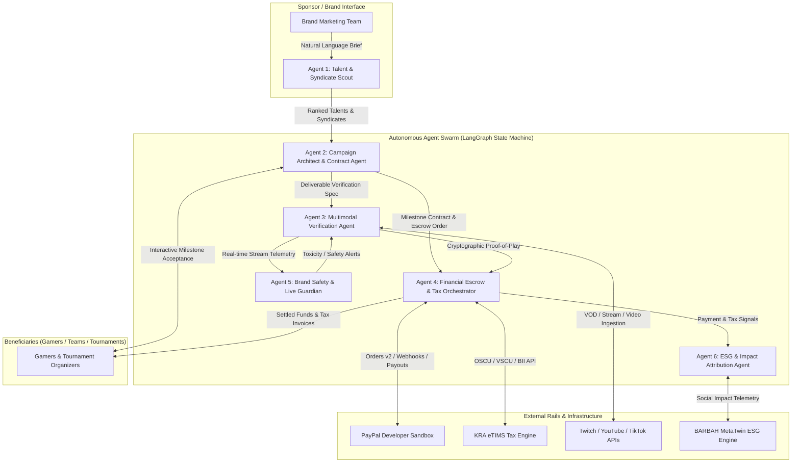
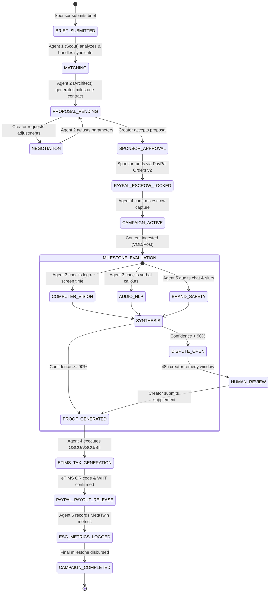

# SPONSORPLAY: Multi-Agent AI Systems Architecture & Autonomous Verification Engine
**Document ID:** SP-ARCH-001  
**Project:** Barbah SponsorPlay (Kenya Esports & Creator Sponsorship Marketplace)  
**Track:** PayPal Global Hackathon - Sponsor Play  
**Author:** Solutions Architect & Systems Engineering Lead  

---

## 1. Executive Architecture Summary

Most sponsorship platforms fail because they treat sponsorship as a static database lookup (a directory) or rely on manual post-campaign audits. In emerging markets like Kenya, where transactions cross informal boundaries, regulatory tax barriers (KRA eTIMS Section 16), and volatile live streaming environments, a static system collapses under administrative friction.

**SponsorPlay is architected as an Autonomous Multi-Agent System (MAS)**. Rather than passive forms, specialized autonomous agents collaborate asynchronously across the campaign lifecycle. These agents understand brand briefs, assemble optimal creator syndicates, draft milestone contracts, continuously verify live deliverables using multimodal computer vision and audio NLP, and orchestrate dual-rail financial settlement across PayPal and KRA eTIMS.



---

## 2. Why Multi-Agent AI (Not Generic Chatbots or Static Directories)

```
+------------------------------------------------------------------------------------------------------------------+
|                                    ARCHITECTURAL PARADIGM COMPARISON                                             |
+--------------------------+-----------------------+-----------------------------+---------------------------------+
| Dimension                | Static Directory      | Simple Chatbot (Single LLM) | SponsorPlay Multi-Agent (MAS)   |
+--------------------------+-----------------------+-----------------------------+---------------------------------+
| Discovery Mechanism      | Rigid filters & search| Conversational search       | Multi-signal syndicate graph    |
| Contract Structuring     | Generic PDF templates | Text generation only        | Executable milestone contracts  |
| Deliverable Verification | Manual human checking | Cannot process media streams| Multimodal Vision + Audio STT   |
| Financial Orchestration  | Disconnected manual   | Zero transactional state    | Autonomous PayPal Escrow + eTIMS|
| Error Recovery           | Human ticket queue    | Hallucinates solutions      | Automated fallback & dispute loop|
+--------------------------+-----------------------+-----------------------------+---------------------------------+
```

---

## 3. Detailed Specification of the 6 Autonomous Agents

### 3.1 Agent 1: Talent Discovery & Micro-Syndicate Scout Agent
* **Role:** Analyzes brand briefs, interrogates the creator identity graph, evaluates authenticity, and synthesizes optimal creator syndicates.
* **Core Capabilities:**
  - **Natural Language Brief Deconstruction:** Extracts target budget, target demographics (e.g., ages 18–24, Nairobi/Eldoret, mobile vs. console), brand values, and campaign goals (reach vs. high engagement vs. grassroots CSR).
  - **Graph-Based Synergy Matching:** Instead of recommending a single mega-influencer, the agent bundles a **"Sponsorship Syndicate"**:
    * 1 Regional Tournament Organizer (High physical crowd density).
    * 2 High-Skill Competitive Streamers (Deep tactical authority).
    * 4 Grassroots Campus Gaming Dens (Hyper-local community immersion).
  - **Audience Overlap Deduplication:** Computes Jaccard similarity across social followers and Discord communities to ensure the brand pays for unique reach rather than redundant impressions.
  - **Tax Readiness Indexing:** Categorizes creators into **eTIMS-Ready (Registered Business)** vs. **BII-Eligible (Informal Youth/Student)** to ensure seamless tax structuring upfront.

### 3.2 Agent 2: Campaign Architect & Autonomous Contract Agent
* **Role:** Translates abstract marketing ideas into legally binding, programmatically verifiable milestone contracts.
* **Core Capabilities:**
  - **Dynamic Milestone Decomposition:** Deconstructs a campaign into three verifiable phases:
    * *Milestone 1 (Mobilization & Asset Placement - 30%):* Stream overlay integration, branded tournament announcement, social media teaser.
    * *Milestone 2 (Live Broadcast Execution - 40%):* Minimum 3 hours of airtime, physical banner placement, minimum 4 verbal shoutcaster callouts.
    * *Milestone 3 (Post-Event Attribution & VOD Archival - 30%):* Highlight clip distribution, tournament bracket certification, audience metric verification.
  - **Pricing Oracle:** Dynamically prices deliverables using local purchasing power parity (PPP), average concurrent viewers (CCV), airtime duration, and competitive engagement rates, eliminating arbitrary price gouging.
  - **Interactive Bilateral Negotiation:** Negotiates parameter adjustments with creators (e.g., if a creator requests +10% budget, the agent asks for an extra 30 minutes of stream airtime or 2 additional TikTok clips).

### 3.3 Agent 3: Multimodal Verification Agent (Proof-of-Play & Proof-of-Delivery Engine)
* **Role:** The objective, tamper-proof referee of the sponsorship. Ingests video streams, social posts, and tournament brackets to verify compliance without human intervention.
* **Multimodal Verification Pipeline:**

```mermaid
graph TD
    VOD[Live Stream VOD / Video Clip / Social Post] --> Splitter[Stream Frame & Audio Extractor]
    
    subgraph "Visual Pipeline (Computer Vision)"
        Splitter -->|Frames (1 FPS)| YOLO[YOLOv8 / Gemini Vision Model]
        YOLO --> BBox[Logo Bounding Box Detection]
        BBox --> ScreenRatio[Screen Area Occupancy >= 3.5%]
        ScreenRatio --> AirtimeCalc[Cumulative Visible Airtime >= Threshold]
    end

    subgraph "Audio Pipeline (Speech-to-Text & NLP)"
        Splitter -->|Audio Track| Whisper[Whisper STT Transcription]
        Whisper --> SemanticNLP[Semantic Brand Mention Matcher]
        SemanticNLP --> KeyphraseCheck[Verbal Slogan / Callout Verified]
    end

    subgraph "Verification Synthesis"
        AirtimeCalc --> Engine[Verification Consensus Engine]
        KeyphraseCheck --> Engine
        Engine -->|Confidence >= 90%| POP[Proof-of-Play Certificate Generated]
        Engine -->|Confidence < 90%| Dispute[Flag for Human Creator Remedy]
    end
```

* **Visual Verification Specs:**
  - Detects brand logo placement across stream frames.
  - Verifies minimum screen occupancy (prevents 2-pixel invisible logos).
  - Verifies absence of visual obstruction (e.g., facecam or chatbox covering the brand asset).
* **Audio Verification Specs:**
  - Detects exact phonetic pronunciation of brand names (e.g., "Safaricom", "Monster Energy").
  - Evaluates sentiment and surrounding context to ensure positive endorsement.
* **Tournament Bracket Verification:**
  - Ingests tournament bracket images/URLs, uses OCR to confirm tournament progression, winner identification, and prize pool qualification.

### 3.4 Agent 4: Financial Escrow & Tax Orchestration Agent (PayPal + KRA eTIMS Bridge)
* **Role:** Orchestrates the dual-rail movement of money and tax compliance. Connects international PayPal payment rails with the Kenyan Revenue Authority eTIMS protocol.
* **Core Capabilities:**
  - **PayPal Orders v2 Multiparty Routing:**
    * Creates checkout orders with `payment_instruction` splitting platform fees (10%) and escrow allocations.
    * Holds funds in a secure milestone escrow state.
  - **KRA eTIMS Protocol Handling:**
    * Interacts with KRA Online Sales Control Unit (OSCU) / Virtual Sales Control Unit (VSCU).
    * Handles **Approach 1 (eTIMS-First)** for registered esports organizations.
    * Handles **Approach 2 (Buyer-Initiated Invoicing - BII)** for informal youth creators, allowing corporate sponsors to legally deduct the marketing expense under Section 16(1)(c).
    * Calculates mandatory **Withholding Tax (WHT)** at 5% for digital content/services under Kenyan tax law.
  - **Programmatic Disbursement:** Upon receiving the cryptographic `Proof-of-Play Certificate` from Agent 3, Agent 4 triggers the PayPal Payout / Capture release and issues the final tax receipt with KRA QR code.

### 3.5 Agent 5: Real-Time Brand Safety & Guardian Agent
* **Role:** Protects sponsor brand equity during high-volatility live broadcasts.
* **Core Capabilities:**
  - **Live Chat Stream Monitoring:** Connects to Twitch IRC / YouTube Live chat websockets to detect spikes in hate speech, racism, slurs, or harassment.
  - **Audio Toxicity Intercept:** Flags live profanity outbursts or derogatory language during the sponsored window.
  - **Competitor Collision Detector:** Flags if a creator accidentally showcases a direct competitor's product (e.g., drinking a competitor's beverage while wearing the sponsor's jersey).
  - **Automated Grace Period:** If a violation occurs, the agent notifies the creator via Discord/SMS webhook with a 15-minute remediation window before halting milestone verification.

### 3.6 Agent 6: ESG & Social Impact Attribution Agent (BARBAH MetaTwin Connector)
* **Role:** Translates raw esports activity into verifiable social, economic, and youth development impact metrics for corporate C-Suites.
* **Core Capabilities:**
  - **Youth Empowerment Indexing:** Tracks how many unique youth gamers from underrepresented backgrounds (informal settlements, secondary cities) earned prize money or creator fees.
  - **Digital Skills Acquisition:** Correlates tournament participation and platform usage with digital literacy, media production skills, and financial inclusion.
  - **Gender Inclusion Ratio:** Quantifies funding allocated to female gaming teams and mixed-gender tournaments.
  - **Executive ESG Dossier Generation:** Exports ISO/GRI-compliant ESG reports that corporate sponsors can include in their annual integrated sustainability reports.

---

## 4. Multi-Agent Orchestration Protocol & State Machine

SponsorPlay orchestrates agent execution using a deterministic **StateGraph** architecture (similar to LangGraph). Agents communicate by passing typed state schemas, preventing hallucinations and ensuring auditable state transitions.



---

## 5. Agentic AI Implementation Tech Stack

* **Agent Framework:** LangGraph / Python 3.11 with TypedDict state encapsulation.
* **LLM Engine:** Gemini 1.5 Pro / Flash (multimodal reasoning, 1M context window for VOD transcripts, rapid JSON schema adherence).
* **Multimodal Perception:**
  - Video Frame Analysis: OpenCV + Gemini Vision API (zero-shot logo detection and bounding box area calculation).
  - Speech Transcription: OpenAI Whisper (large-v3) with Swahili & Sheng (Kenyan youth slang) lexical adaptation.
* **Data Layer & Event Bus:** Redis Pub/Sub for live agent state messaging + PostgreSQL with pgvector for semantic creator embeddings.
* **External Tooling:** PayPal REST SDK (v2), Mock KRA eTIMS VSCU API, Twitch Helix API, YouTube Data API v3.
