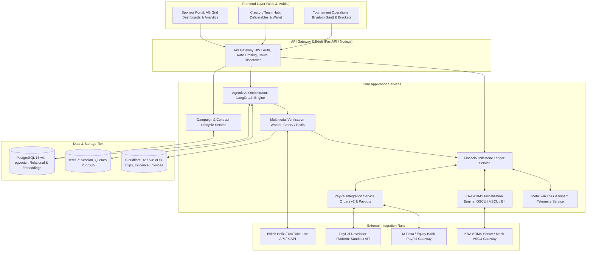
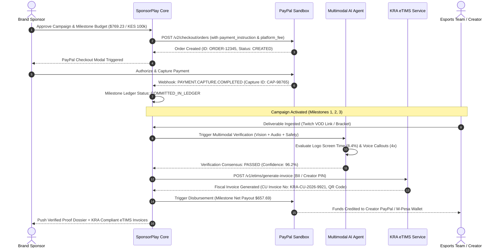
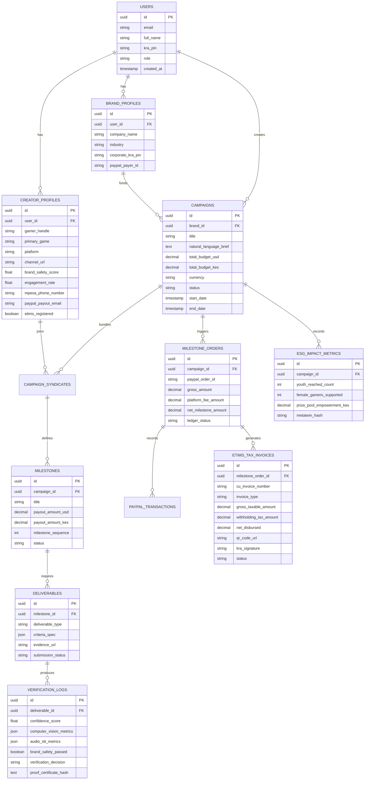

# SPONSORPLAY: Technical Architecture & PayPal + KRA eTIMS Integration
**Document ID:** SP-ARCH-002  
**Project:** Barbah SponsorPlay (Kenya Esports & Creator Sponsorship Marketplace)  
**Track:** PayPal Global Hackathon - Sponsor Play  
**Author:** Solutions Architect & Systems Engineering Lead  

---

## 1. High-Level Component & Systems Architecture

SponsorPlay is engineered as a modern, decoupled micro-modular platform designed for high availability, auditable financial transactions, and low-latency multimodal AI inference.



---

## 2. The PayPal + KRA eTIMS Dual-Rail Financial Engine

Connecting international payment rails (PayPal) with Kenya's electronic tax invoicing mandate (KRA eTIMS) is the central financial breakthrough of SponsorPlay. 

### 2.1 The Core Financial Mathematics & Fee Flow
Consider a corporate sponsor committing a **KES 100,000 (approx. $770.00 USD)** sponsorship budget to an esports team or creator.

```
+--------------------------------------------------------------------------------------------------+
|                                    FLOW OF FUNDS BREAKDOWN                                       |
+------------------------------------------------------+--------------------+----------------------+
| Ledger Entry                                         | Amount (KES)       | Amount (USD @ 130)   |
+------------------------------------------------------+--------------------+----------------------+
| 1. Gross Campaign Budget (Sponsor Authorized)        | KES 100,000.00     | $769.23              |
| 2. SponsorPlay Platform Facilitation Fee (10%)       | KES  10,000.00     | $ 76.92              |
| 3. Gross Beneficiary Sponsorship Allocation (90%)    | KES  90,000.00     | $692.31              |
| 4. Statutory Withholding Tax (WHT @ 5% on Creator)   | KES   4,500.00     | $ 34.62              |
| 5. Net Liquid Cash Disbursed to Creator              | KES  85,500.00     | $657.69              |
+------------------------------------------------------+--------------------+----------------------+
| Tax Invoice Reconciliation (Provided to Sponsor):                                                |
| - Platform Fee eTIMS Tax Invoice (Barbah Games):     | KES  10,000.00     | (Section 16 Valid)   |
| - Creator Sponsorship eTIMS Invoice (Direct or BII): | KES  90,000.00     | (Section 16 Valid)   |
| Total Tax-Deductible eTIMS Invoices Delivered:       | KES 100,000.00     | (100% Tax Deductible)|
+------------------------------------------------------+--------------------+----------------------+
```

### 2.2 Dual-Rail Transaction Sequence (Mermaid)



---

## 3. PayPal Developer Platform Technical Integration

SponsorPlay leverages the PayPal REST API v2 suite to ensure enterprise-grade security and full compliance.

### 3.1 Creating the Multiparty Order with Platform Commission
We utilize `POST /v2/checkout/orders` with `payment_instruction.platform_fees` to ensure the platform commission is collected transparently while the sponsorship funds are isolated.

#### API Request: `POST /v2/checkout/orders`
```json
{
  "intent": "CAPTURE",
  "purchase_units": [
    {
      "reference_id": "SP-CAMP-2026-0042",
      "description": "SponsorPlay: Safaricom Campus Esports Cup - Team Alpha Sponsorship",
      "custom_id": "BENEFICIARY_CREATOR_ID_9901",
      "amount": {
        "currency_code": "USD",
        "value": "769.23",
        "breakdown": {
          "item_total": {
            "currency_code": "USD",
            "value": "769.23"
          }
        }
      },
      "items": [
        {
          "name": "Esports Tournament Tier-1 Sponsorship Deliverables",
          "unit_amount": {
            "currency_code": "USD",
            "value": "769.23"
          },
          "quantity": "1",
          "category": "DIGITAL_GOODS"
        }
      ],
      "payee": {
        "email_address": "barbah-marketplace-facilitator@barbahgames.com"
      },
      "payment_instruction": {
        "disbursement_mode": "INSTANT",
        "platform_fees": [
          {
            "amount": {
              "currency_code": "USD",
              "value": "76.92"
            },
            "payee": {
              "email_address": "treasury@barbahgames.com"
            }
          }
        ]
      }
    }
  ],
  "application_context": {
    "brand_name": "Barbah SponsorPlay",
    "locale": "en-KE",
    "landing_page": "BILLING",
    "user_action": "PAY_NOW",
    "return_url": "https://sponsorplay.barbahgames.com/campaigns/42/payment-success",
    "cancel_url": "https://sponsorplay.barbahgames.com/campaigns/42/payment-cancelled"
  }
}
```

### 3.2 Webhook Ingestion & Milestone Ledger Commitment
The platform registers listeners for the following critical PayPal Webhook events:
* `CHECKOUT.ORDER.APPROVED`: Signals that the sponsor authorized the transaction.
* `PAYMENT.CAPTURE.COMPLETED`: Emitted when funds are captured. Triggers internal ledger event `EVENT_MILESTONES_FUNDED`.
* `PAYMENT.CAPTURE.DENIED` / `PAYMENT.CAPTURE.REFUNDED`: Triggers automated rollback and campaign freeze.

### 3.3 Programmatic Payouts to Beneficiaries
Upon milestone completion and eTIMS certification, the Financial Agent calls `POST /v1/payments/payouts`:
```json
{
  "sender_batch_header": {
    "sender_batch_id": "BATCH_SP_MILESTONE_42_M1",
    "email_subject": "SponsorPlay: Milestone 1 Sponsorship Payment Released",
    "email_message": "Your deliverable was verified by AI and tax certified via KRA eTIMS. Funds have been released."
  },
  "items": [
    {
      "recipient_type": "EMAIL",
      "amount": {
        "value": "657.69",
        "currency": "USD"
      },
      "note": "Net payout for Safaricom Campus Cup (WHT 5% withheld under KRA rules)",
      "sender_item_id": "MILESTONE_RELEASE_ITEM_1001",
      "receiver": "captain_kevin_esports@gmail.com"
    }
  ]
}
```

---

## 4. KRA eTIMS Protocol Specification & BII Workflow

To satisfy **Section 16(1)(c) of the Kenya Income Tax Act**, every payment must map to an official KRA Control Unit electronic tax invoice.

### 4.1 Approach 1: eTIMS-First Workflow (Registered Esports Entities)
For incorporated gaming organizations (e.g., registered LLCs or business names with existing KRA PINs):
1. The gaming organization's system generates an eTIMS electronic tax invoice via the KRA Online Sales Control Unit (OSCU).
2. The invoice payload is sent to SponsorPlay with:
   - KRA PIN of Creator.
   - KRA PIN of Sponsor.
   - Total Amount (inclusive of VAT if registered).
   - Control Unit Internal Data & Fiscal Signature.
3. SponsorPlay validates the invoice authenticity via KRA's validation endpoint before triggering PayPal checkout.

### 4.2 Approach 2: Buyer-Initiated Invoicing (BII) Workflow (Informal Youth Creators)
For the 80%+ of grassroots gamers and student organizers who lack corporate accounting setups:
1. Under **Section 23A of the Tax Procedures Act**, KRA permits Buyer-Initiated Invoicing (BII) where the purchaser (or certified platform aggregator) generates the fiscal document on behalf of the informal supplier.
2. The creator signs an electronic BII authorization during onboarding using their personal KRA PIN and National ID.
3. When the milestone is verified, the **Financial Agent triggers SponsorPlay's certified VSCU client** to generate the official tax invoice.
4. The system calculates and withholds the **5% Withholding Tax (WHT)** on digital services, remits the WHT directly to KRA's portal via iTax, and transmits the official KRA QR Code receipt to both the Sponsor and the Creator.

#### Mock eTIMS VSCU JSON Schema Payload:
```json
{
  "control_unit": {
    "device_serial": "VSCU-KENYA-BARBAH-001",
    "firmware_version": "v2.4.1-certified"
  },
  "invoice_details": {
    "invoice_number": "SP-INV-2026-0042",
    "invoice_date": "2026-11-07T12:00:00Z",
    "transaction_type": "BUYER_INITIATED_INVOICE",
    "currency": "KES"
  },
  "supplier": {
    "pin": "A011982736Z",
    "name": "Kevin Otieno (Competitive Gaming Solo Proprietor)",
    "address": "Nairobi, Kenya",
    "status": "UNREGISTERED_VAT_INDIVIDUAL"
  },
  "buyer": {
    "pin": "P051234567A",
    "name": "Safaricom PLC",
    "address": "HQ Safaricom House, Waiyaki Way, Nairobi"
  },
  "items": [
    {
      "item_code": "HS-82101500",
      "description": "Digital Esports Broadcast Sponsorship & Influencer Activation",
      "quantity": 1,
      "unit_price": 90000.00,
      "total_amount": 90000.00,
      "tax_rate_code": "EXEMPT_OR_ZERO_RATED_TURNOVER",
      "tax_amount": 0.00
    }
  ],
  "withholding_tax": {
    "rate_percent": 5.0,
    "amount_deducted": 4500.00,
    "net_payable": 85500.00
  },
  "fiscal_output": {
    "cu_invoice_number": "KRA00202611079921",
    "qr_verification_url": "https://etims.kra.go.ke/verify?cu=KRA00202611079921&pin=P051234567A",
    "digital_signature": "MEUCIQCv3r8k...vQp9c="
  }
}
```

---

## 5. Complete Database Entity-Relationship (ER) Schema



---

## 6. Postman & API Endpoint Test Collection

To ensure seamless hackathon evaluation, the core API endpoints are exposed and documented for Postman execution:

```
+---------------------------------------------------------------------------------------------------------+
|                                    SPONSORPLAY CORE API ROUTE MATRIX                                    |
+--------+---------------------------------------+--------------------------------------------------------+
| Method | Endpoint                              | Purpose / Workflow Step                                |
+--------+---------------------------------------+--------------------------------------------------------+
| POST   | /api/v1/campaigns/brief               | Submit natural language brief to Agent 1 (Scout)       |
| GET    | /api/v1/campaigns/:id/recommendations | Retrieve AI-generated creator syndicate & bundles      |
| POST   | /api/v1/campaigns/:id/proposal        | Agent 2 generates milestone proposal contract          |
| POST   | /api/v1/payments/create-order         | Initialize PayPal Orders v2 with platform fee split    |
| POST   | /api/v1/webhooks/paypal               | Listen for PayPal Capture & Payment notifications      |
| POST   | /api/v1/verification/ingest-media     | Submit VOD stream link or evidence to Agent 3 (Vision) |
| GET    | /api/v1/verification/:id/certificate  | Retrieve tamper-proof Proof-of-Play consensus audit    |
| POST   | /api/v1/tax/etims/generate            | Agent 4 triggers OSCU/VSCU or BII tax invoice          |
| POST   | /api/v1/payments/disburse-milestone   | Release PayPal Payout upon verified proof & tax invoice|
| GET    | /api/v1/impact/metatwin-report        | Export C-Suite ESG & youth development report          |
+--------+---------------------------------------+--------------------------------------------------------+
```
