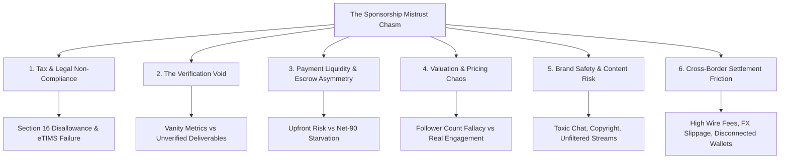

# SPONSORPLAY: Stakeholder Empathy & Mistrust Root-Cause Analysis
**Document ID:** SP-RES-001  
**Project:** Barbah SponsorPlay (Kenya Esports & Creator Sponsorship Marketplace)  
**Track:** PayPal Global Hackathon - Sponsor Play  
**Author:** Solutions Architect & Systems Engineering Lead  

---

## 1. Executive Summary

Sponsorship in emerging esports ecosystems, particularly in Kenya and Sub-Saharan Africa, is broken not because of a lack of interest or talent, but because of a **fundamental trust deficit** between corporate brand sponsors and grassroots gaming creators.

Kenya boasts an estimated video gaming and digital audience market valued between **$100 million and $137 million**, with over 85% mobile and console gaming density among urban youth. Corporate giants (e.g., Safaricom, Red Bull, KCB Bank, East African Breweries, Monster Energy, Asus ROG) eagerly desire authentic touchpoints with Gen-Z and digital natives. Simultaneously, Kenya's gaming creators, grassroots esports teams (in estates like Kayole, Pipeline, and Githurai, as well as university clans), and tournament organizers operate in severe financial starvation.

The chasm between them is characterized by **structural friction, legal/tax barriers, verification voids, and asymmetric risk**. This document provides an empathetic, forensic analysis of the core user personas, the root causes of mutual mistrust, and the precise technical mechanisms through which SponsorPlay transforms mistrust into programmatic trust.

---

## 2. Deep Persona Empathy Mapping

### 2.1 Persona 1: The Corporate Brand & Marketing Director
* **Name:** "Corporate Carol" – Head of Brand & Digital Marketing at an East African FMCG / Telco / Fintech.
* **Context:** Manages an annual youth marketing budget of KES 50M ($380,000). Pressured to demonstrate high ROI, youth brand affinity, and corporate compliance.
* **Mental Model & Day-to-Day Realities:**
  - Audited ruthlessly by CFO and internal compliance teams.
  - Bound by **Section 16(1)(c) of the Kenya Income Tax Act**, which dictates that **any business expense not accompanied by a valid KRA eTIMS electronic tax invoice will be disallowed**, imposing an automatic 30% corporate tax penalty on the company.
  - Used to dealing with established advertising agencies that provide Net-60 or Net-90 credit terms, audited media reports, and indemnity insurance.
  - Considers gaming an exciting frontier but regards gaming creators as unvetted, high-risk, informal operators.
* **Core Anxieties & Fears:**
  1. **Vanity Metric Fraud:** "Is this streamer's 15,000-viewer stream real, or is it inflated by cheap Twitch bots and simulated traffic?"
  2. **Influencer Ghosting & Deliverable Non-Compliance:** "We paid a 50% deposit upfront; the tournament organizer postponed the event twice, displayed our logo for 3 minutes on a blurry stream, and stopped answering WhatsApp calls."
  3. **Brand Safety & Reputational Blast Radius:** "What if an esports player wears our branded jersey while shouting toxic slurs, engaging in hate speech, or streaming unlicensed copyrighted music that triggers a public backlash?"
  4. **The Procurement & Tax Audit Nightmare:** "If my department disburses KES 250,000 to an unregistered gaming clan via M-Pesa without an eTIMS electronic fiscal receipt, KRA will penalize our company, and I will face internal disciplinary action."

```
+---------------------------------------------------------------------------------------------------+
|                                  CORPORATE SPONSOR PAIN MATRIX                                    |
+--------------------------+--------------------------------------+---------------------------------+
| Pain Point               | Underlying Fear                      | Financial / Legal Impact        |
+--------------------------+--------------------------------------+---------------------------------+
| Non-Compliant Invoicing  | KRA Tax Audit Penalties              | 30% Corporate Tax Disallowance  |
| Phantom Deliverables     | Sunk Marketing Spend                 | Zero Measurable Attribution     |
| Brand Toxicity           | PR Scandals & Community Backlash     | Brand Equity Impairment         |
| Slow Procurement Cycles  | Internal Bureaucratic Gridlock       | Inability to execute agile deals|
+--------------------------+--------------------------------------+---------------------------------+
```

---

### 2.2 Persona 2: The Grassroots Esports Team / Streamer / Gamer
* **Name:** "Competitive Kevin" – Semi-pro EA FC (FIFA) / Call of Duty Mobile team captain and Twitch/YouTube streamer from Nairobi.
* **Context:** Commands a fiercely loyal community of 4,000 active gamers across Discord, WhatsApp gaming groups, and YouTube. Works off mobile broadband and a leased gaming rig.
* **Mental Model & Day-to-Day Realities:**
  - Operates on a hand-to-mouth digital hustle; needs immediate funds to pay for high-speed fiber internet, tournament registration fees, equipment upgrades, and daily living expenses.
  - Has repeatedly been burned by predatory "sponsors" offering "exposure," branded t-shirts, or vague promises of prize pools that never materialize.
  - Intimidated by corporate procurement paperwork, 40-page Master Service Agreements (MSAs), VAT withholding certificates, and complex tax compliance software.
* **Core Anxieties & Fears:**
  1. **Exploitation & Payment Defaults:** "Brands want me to plaster their logo all over my stream and social feeds for three weeks, but they only offer to pay after 90 days, or worse, they dispute the metrics and ghost me entirely."
  2. **Scope Creep Without Compensation:** "The sponsor agreed to a simple logo overlay, but on event day they demanded that our players do 5 extra video interviews, hand out physical flyers, and post 10 TikToks without adding a single shilling."
  3. **Financial Exclusion & Cross-Border Friction:** "When an international gaming accessories brand or game publisher wants to sponsor our roster, wire transfers take two weeks, get stuck in intermediary banks, or lose 15% in foreign exchange and banking fees."
  4. **Fear of Tax Authorities:** "I don't have an enterprise ERP or an expensive OSCU fiscal device. If I sign a formal contract, will KRA freeze my personal M-Pesa account?"

```
+---------------------------------------------------------------------------------------------------+
|                                   GAMING CREATOR PAIN MATRIX                                      |
+--------------------------+--------------------------------------+---------------------------------+
| Pain Point               | Underlying Fear                      | Financial / Livelihood Impact   |
+--------------------------+--------------------------------------+---------------------------------+
| "Payment in Exposure"    | Uncompensated Labor & Exploitation   | Inability to sustain full-time  |
| Net-90 Payment Terms     | Cash-flow Starvation                 | Default on internet / rent fees |
| Unilateral Scope Creep   | Power Imbalance in Negotiations      | Burnout & community cynicism    |
| Cross-border Remittance  | Withholding fees & Banking red-tape  | High loss of earnings (10-18%)  |
+--------------------------+--------------------------------------+---------------------------------+
```

---

### 2.3 Persona 3: The Tournament Organizer / Gaming Den Operator
* **Name:** "Organizer Omar" – Runs grassroots LAN tournaments in gaming lounges across Nairobi (e.g., Kayole, Westlands) and university campus circuits.
* **Context:** Brings together 32 teams and 500 physical spectators, plus online stream broadcasts. Relies on razor-thin entry fee margins and sporadic sponsor contributions.
* **Mental Model & Day-to-Day Realities:**
  - Caught in the middle between demanding corporate sponsors who want perfection and hyper-critical players who expect immediate cash prize payouts upon winning.
  - Must pay venue hire, electrical generators, shoutcasters, and equipment rentals upfront.
* **Core Anxieties & Fears:**
  1. **Prize Pool Default Catastrophe:** "If a sponsor commits KES 300,000 for the tournament prize pool but fails to disburse the funds on tournament weekend, the players will accuse me of theft and destroy my community reputation."
  2. **Inability to Prove Physical + Digital Engagement:** "I know 600 gamers packed the gaming lounge and cheered for 8 hours, but how do I prove that to a sponsor who only cares about digital dashboard metrics?"
  3. **High Operational Cash Burden:** "I have to front cash for the sound system and internet connectivity out of my pocket while waiting for corporate approval queues."

---

## 3. The 6 Root Causes of Sponsorship Mistrust



### Root Cause 1: Tax & Legal Non-Compliance (The Section 16 Disallowance Wall)
In Kenya, the corporate marketing spend is strictly governed by tax law. Under Section 16(1)(c) of the Income Tax Act, any corporate expense claimed for tax deduction must be supported by an **electronic tax invoice generated through KRA eTIMS**.
* If a corporate sponsor funds an unregistered gaming squad with KES 500,000 without an eTIMS invoice, KRA disallows the expense during annual corporate tax assessment.
* The corporate is forced to pay **30% corporate income tax** on that KES 500,000 (an effective KES 150,000 penalty!).
* As a result, corporate compliance officers actively block sponsorship deals with grassroots youth, locking 90% of gaming talent out of commercial revenue.

### Root Cause 2: The Verification Void (Vanity Metrics vs. Phantom Deliverables)
Traditional sponsorships rely on post-campaign self-reporting.
* Creators send PDF screenshots of Twitch analytics or Twitter impressions that can be easily forged, bought via bot farms, or taken out of context.
* Sponsors have no automated way to verify:
  - Did the streamer actually display the sponsor's logo overlay for the full 4 hours agreed upon?
  - Was the logo obscured by a game minimap or facecam?
  - Did the tournament shoutcaster deliver the mandatory verbal brand callouts at each match transition?
  - Did the branded banner stay hung behind the finalist stage throughout the LAN final?
* The lack of objective, real-time proof breeds cynical second-guessing on both sides.

### Root Cause 3: Payment Liquidity & Escrow Asymmetry
* The Brand's dilemma: "If I pay 100% upfront, the creator has no incentive to deliver high-quality execution. If they underperform, recovering the money in small claims court is legally impossible."
* The Creator's dilemma: "If I deliver the entire campaign without upfront funding, the brand will invent excuses, renegotiate post-facto, or force me into a Net-90 payment cycle where I cannot pay my bills."
* Without an automated, neutral escrow mechanism that releases funds based on programmatic proof of delivery, one party is always held hostage by the other.

### Root Cause 4: Valuation & Pricing Chaos (The Follower Count Fallacy)
* Pricing in African esports is completely arbitrary. There is no transparent CPM, CPV (Cost Per View), or Cost-Per-Engaged-Gamer benchmark.
* Micro-streamers with 500 hyper-engaged Kenyan gamers in a competitive Discord server often get overlooked for mainstream lifestyle influencers with 50,000 fake Instagram followers who generate zero gaming conversions.
* Grassroots creators underprice their value (charging KES 5,000 for 40 hours of work) or wildly overprice it (demanding KES 200,000 without audience demographic proof), leaving sponsors bewildered.

### Root Cause 5: Brand Safety & Live Content Volatility
* Esports streams are live, unscripted, and intense. A gamer screaming in frustration might blurt out offensive slurs or stream unlicensed copyrighted music.
* Corporate brands in highly regulated sectors (banking, telecom, insurance) have zero tolerance for brand contamination.
* Without real-time guardian systems that audit streams, filter toxic chat environments, and monitor community sentiment, brands refuse to expose their trademarks to unmonitored live streams.

### Root Cause 6: Cross-Border Settlement & Currency Friction
* Global brands (Razer, Logitech, Twitch, Red Bull Global, PayPal) operate in USD, EUR, or GBP. Local Kenyan talent operates in KES and relies on mobile money (M-Pesa).
* Traditional international wire transfers (SWIFT) incur fixed fees of $30–$50 per transfer, taking 3 to 7 business days, making micro-sponsorships ($100–$500) economically unfeasible.
* Gamers without formal dollar bank accounts struggle to receive international sponsorship payouts smoothly.

---

## 4. How SponsorPlay Transforms Mistrust into Programmatic Trust

SponsorPlay replaces subjective human negotiation, manual invoicing, and emotional disputes with an **Agentic AI & Dual-Rail Financial Infrastructure**:

```
+---------------------------------------------------------------------------------------------------------+
|                                     THE TRUST TRANSFORMATION ENGINE                                     |
+--------------------------+------------------------------------------+-----------------------------------+
| Point of Friction        | Traditional broken process               | SponsorPlay Programmatic Solution |
+--------------------------+------------------------------------------+-----------------------------------+
| Tax Deductibility        | Non-compliant manual receipts or cash    | Automated eTIMS OSCU/VSCU + BII   |
| Deliverable Verification | Manipulated screenshots & manual audits  | Multimodal AI Proof-of-Play Engine|
| Payment Security         | 50% upfront gamble or Net-90 starvation  | PayPal Smart Milestone Escrow     |
| Campaign Valuation       | Guesswork based on vanity follower counts| Dynamic AI Valuation & Syndicate  |
| Brand Safety             | Hope & prayer during unscripted streams  | Real-time Audio/Vision Guardian   |
| Cross-Border Payments    | Expensive SWIFT wires ($45 fee, 5 days)  | PayPal Orders v2 & M-Pesa Bridge  |
+--------------------------+------------------------------------------+-----------------------------------+
```

By resolving every single structural root cause, SponsorPlay unlocks an untapped multi-million dollar creator economy in Kenya and establishes a reproducible blueprint for emerging markets across Africa.
