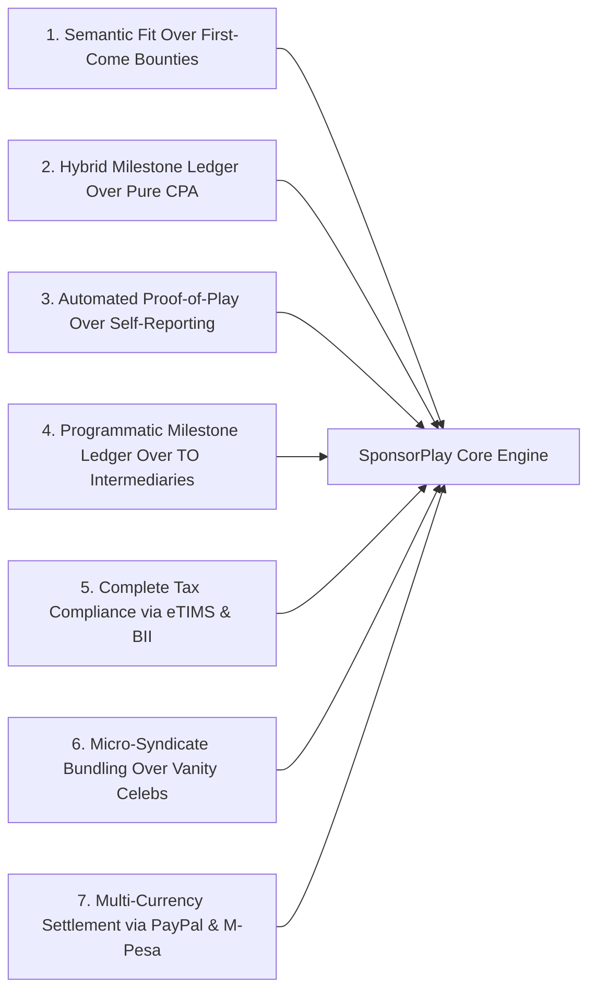

# SPONSORPLAY: Global & African Industry Case Studies & Forensic Post-Mortems
**Document ID:** SP-RES-002  
**Project:** Barbah SponsorPlay (Kenya Esports & Creator Sponsorship Marketplace)  
**Track:** PayPal Global Hackathon - Sponsor Play  
**Author:** Solutions Architect & Systems Engineering Lead  

---

## 1. Executive Summary

To build an enduring, venture-backable startup in the gaming sponsorship space, we must systematically study prior attempts to industrialize creator deals and esports sponsorships. Many well-funded platforms (Twitch, StreamElements, Matcherino) have attempted to automate sponsorships; several collapsed, pivoted under distress, or suffered severe reputational failure.

This document dissects **five landmark case studies** across the global and African creator economies. By conducting a forensic post-mortem on what broke and why, we extract the core architectural requirements that ensure SponsorPlay avoids these fatal failure modes while pioneering the first verified sponsorship engine in Africa.

---

## 2. Comparative Matrix of Predecessor Platforms

```
+-------------------------------------------------------------------------------------------------------------------------+
|                                    COMPARATIVE ANALYSIS OF PRIOR SPONSORSHIP PLATFORMS                                   |
+---------------------+-------------------+---------------------+-------------------------+-------------------------------+
| Platform            | Target Ecosystem  | Core Model          | Primary Failure Mode    | SponsorPlay Strategic Lesson  |
+---------------------+-------------------+---------------------+-------------------------+-------------------------------+
| Twitch Bounty Board | Global Streamers  | Algorithmic task-   | Disintermediation, rigid| AI Agent must negotiate       |
|                     |                   | based bounties      | robotic ads, community  | natural narrative integration |
|                     |                   |                     | authenticity backlash   | rather than rigid ad-reads    |
+---------------------+-------------------+---------------------+-------------------------+-------------------------------+
| StreamElements      | Mid-tier creators | Free overlay tools  | Attribution death trap  | Never rely purely on CPA; use |
| Sponsorships        | ($111M VC raised) | subsidized by CPA   | (ad-blockers, zero-pay  | milestone-backed hybrid       |
|                     |                   | brand activations   | disputes), massive burn | verified Proof-of-Play        |
+---------------------+-------------------+---------------------+-------------------------+-------------------------------+
| Matcherino          | Grassroots FGC &  | Crowdfunded prize   | Grassroots accounting   | Programmatic PayPal milestone ledger    |
|                     | esports tourneys  | pools & promo codes | scandals, organizer     | with automated proof-of-      |
|                     |                   |                     | fraud, sponsor retreat  | tournament deliverable release|
+---------------------+-------------------+---------------------+-------------------------+-------------------------------+
| FaZe Clan & TSM     | Tier-1 Esports    | High-CPM mega-deals | Vanity metric bubble,   | Micro-syndicates with verified|
| (Esports Winter)    | Franchises        | & naming rights     | unmeasured ROI, massive | real youth reach over inflated|
|                     |                   | ($210M FTX deal)    | overhead, crash         | influencer vanity stats       |
+---------------------+-------------------+---------------------+-------------------------+-------------------------------+
| Safaricom Blaze &   | Kenya Pop Culture | Bespoke corporate   | Manual procurement,     | Automated KRA eTIMS & BII to  |
| Otamatsuri (Kenya)  | & LAN Tournaments | event sponsorships  | unorganized long-tail,  | unlock corporate budgets for  |
|                     |                   | (PSG, KICC)         | Section 16 tax barrier  | grassroots tournament dens    |
+---------------------+-------------------+---------------------+-------------------------+-------------------------------+
```

---

## 3. Forensic Post-Mortem 1: Twitch Bounty Board (Disintermediation & Algorithmic Rigidity)

### 3.1 What it Attempted
Launched in 2018, Twitch Bounty Board aimed to allow game publishers and corporate brands to post self-service "bounties" (e.g., "Stream Game X for 2 hours with game title and logo overlay for $150"). Eligible Twitch Affiliates and Partners could claim bounties on a first-come, first-served dashboard.

### 3.2 The Failure Mechanism
1. **The "Sellout" Authenticity Backlash:** Streamers who normally played tactical FPS games accepted bounties for unrelated mobile gacha games purely for quick cash. Viewers instantly revolted, calling out inauthentic corporate shilling. Viewership plunged during bounty windows, harming the streamer's long-term organic retention.
2. **Brittle Algorithmic Enforcement:** If a streamer's internet dropped for 90 seconds or Twitch's detection script failed to register the category tag for 5 minutes of a 120-minute stream, the bounty was cancelled automatically, paying $0 and issuing a penalty strike on the creator's account.
3. **Advertiser Disillusionment:** Brands received robotic, disinterested gameplay where streamers sat silently on camera waiting for the 2-hour timer to expire. Conversion rates were abysmal, leading advertisers to abandon the automated board and return to bespoke agency campaigns.

### 3.3 SponsorPlay Architectural Takeaway
* **Semantic Community Fit:** SponsorPlay does not use first-come, first-served boards. The **Talent Scout Agent** evaluates deep game affinity, community tone, and audience overlap before ever suggesting a sponsorship.
* **Human-in-the-Loop Negotiation:** The **Campaign Architect Agent** facilitates co-created deliverables rather than rigid corporate scripts, preserving authentic gaming culture.

---

## 4. Forensic Post-Mortem 2: StreamElements Sponsorships (The Conversion Attribution Death Trap)

### 4.1 What it Attempted
StreamElements raised over $111 million (led by SoftBank Vision Fund 2) to build a creator operating system. To monetize its free overlay and chatbot tools, it built an in-dashboard sponsorship marketplace matching mid-tier creators with brands (e.g., Raid: Shadow Legends, HelloFresh, NordVPN).

### 4.2 The Failure Mechanism
1. **The Pure CPA (Cost-Per-Action) Trap:** Campaigns were structured on conversion goals (e.g., "Viewer must reach Level 10 in mobile game or enter promo code at checkout").
2. **Attribution Blindness:** Streaming audiences consume content across desktop, TV, and mobile. A viewer watching a Twitch stream on PC frequently downloaded the game on their iPhone without using the tracking link. Furthermore, ad-blockers, iOS privacy changes (ATT), and browser cookie restrictions wiped out tracking data.
3. **Creator Burnout & Alienation:** Streamers who dedicated 20 hours of airtime and generated hundreds of thousands of impressions received zero dollars because downstream attribution failed. Creators felt cheated; brands felt underwhelmed.
4. **Venture Burn & Fire Sale:** The unit economics collapsed under massive customer acquisition costs and low creator retention, forcing severe layoffs and leading to an emergency intellectual property acquisition by Razer.

### 4.3 SponsorPlay Architectural Takeaway
* **Hybrid Guaranteed Base + Performance Milestones:** Never subject creators to 100% downstream attribution risk. SponsorPlay couples an airtime/visibility base guarantee (Milestone 1 & 2 verified via computer vision) with community engagement bonuses (Milestone 3).
* **Deterministic Proof-of-Delivery:** Verify what the creator actually controls (screen time, logo placement, verbal endorsements, tournament execution) rather than tracking volatile third-party consumer downloads.

---

## 5. Forensic Post-Mortem 3: Matcherino (Grassroots Accounting Scandals & Non-Endemic Retreat)

### 5.1 What it Attempted
Matcherino targeted the Fighting Game Community (FGC) and grassroots esports (Tekken, Street Fighter, Smash Bros, Rocket League). It allowed fans and brands to inject funds into community prize pools using coupon codes and micro-donations.

### 5.2 The Failure Mechanism
1. **Decentralized Tournament Organizer Mismanagement:** Matcherino routed money to community tournament organizers (TOs). Multiple high-profile scandals erupted where TOs withheld prize money, embezzled community funds, or failed to pay competitors for months.
2. **The "Wild West" Compliance Deficit:** Non-endemic brands (e.g., car manufacturers, consumer electronics) that experimented with Matcherino were horrified to find zero formal tax documentation, no auditable receipts, and severe PR exposure when community drama surfaced on Twitter/Reddit.
3. **Sponsor Flight:** Risk-averse enterprise sponsors pulled their marketing dollars out of grassroots esports entirely, leaving the ecosystem even more starved.

### 5.3 SponsorPlay Architectural Takeaway
* **Programmatic Dual-Rail Milestone Ledger:** Funds never sit in an individual organizer's personal checking account. They are locked in a **PayPal Programmatic Milestone Ledger** and released directly to winners and verified suppliers upon algorithmic proof of bracket completion.
* **KRA eTIMS Auditability:** Every transaction is tied to a formal fiscal receipt, providing complete tax and regulatory shielding for corporate sponsors.

---

## 6. Forensic Post-Mortem 4: FaZe Clan & TSM (The "Esports Winter" Vanity Bubble)

### 6.1 What it Attempted
During the 2018–2021 esports boom, tier-1 organizations commanded astronomical valuations (FaZe Clan went public at a $1 billion valuation; TSM signed a $210 million naming rights deal with crypto exchange FTX). They sold corporate sponsors on massive cumulative follower counts and high-CPM vanity metrics.

### 6.2 The Failure Mechanism
1. **The Vanity Metric Deception:** Sponsors paid millions of dollars based on Twitter follower counts and aggregate YouTube views. However, audience overlap was massive, and real engagement was diluted across disparate lifestyle entertainment rather than focused gaming intent.
2. **The Crypto & FTX Contagion:** When FTX collapsed into bankruptcy fraud, TSM was stripped of its naming rights deal, exposing the brittle reliance on single speculative sponsors.
3. **The Public Market Crash:** FaZe Clan's stock collapsed by more than 98% within 18 months, leading to a distressed buyout by GameSquare at a fraction of its peak valuation. The entire sector entered the "Esports Winter," with sponsors slashing budgets by 60–80%.

### 6.3 SponsorPlay Architectural Takeaway
* **Micro-Audience Syndication:** The future of esports sponsorship is not a $10M bet on a single bloated celebrity team; it is the programmatic aggregation of 50 hyper-local, high-affinity gaming squads and campus communities into an automated **Sponsorship Syndicate**.
* **Real Unit Economics:** Grounded pricing models based on verified local reach in emerging economies, offering sustainable ROI for brands and stable recurring income for creators.

---

## 7. The African & Kenyan Corporate Reality: Safaricom Blaze, Otamatsuri & The Grassroots Chasm

### 7.1 What Currently Works
* **Safaricom Blaze Esports & MobiPlay:** Safaricom has proven that youth gaming drives mobile data consumption, 5G adoption, and brand affinity. Tournaments like Blaze Esports (in partnership with Pro Series Gaming) and pop-culture conventions like **Otamatsuri at KICC** drew thousands of passionate youth.
* **Neighborhood Gaming Lounges ("Playstations"):** In high-density estates across Nairobi (Kayole, Pipeline, Githurai, Rongai, Westlands), gaming dens run daily peer-to-peer EA FC (FIFA) and Tekken tournaments powered entirely by M-Pesa entry fees. Pro-gamers like Brian "The Beast" Diang'a (from Kibera) have shown that African esports talent can achieve global prominence.

### 7.2 Why the Grassroots Market Remains Starved
1. **Ad-Hoc Manual Procurement:** Corporate deals currently take 3 to 6 months of agency meetings, manual procurement vetting, and legal drafting. Brands only sponsor 1 or 2 mega-events per year because the administrative overhead of managing 50 smaller tournaments is prohibitive.
2. **The Section 16 Tax Wall:** When a grassroots gaming lounge in Kayole wants KES 50,000 to run an EA FC championship, Safaricom or Guinness Kenya cannot sponsor them directly unless the lounge provides an eTIMS electronic tax invoice. If they don't, the brand loses 30% in tax disallowances.
3. **The Missing Middleware:** There has never been an intelligent digital platform in Kenya that bridges corporate procurement, PayPal cross-border payments, KRA eTIMS fiscalization, and real-time deliverable verification.

---

## 8. The 7 Non-Negotiable Architectural Principles for SponsorPlay

From these 5 case studies, SponsorPlay establishes seven non-negotiable systems engineering principles:



1. **Semantic Fit Over Rigid Bounties:** Never force creators into cookie-cutter ad reads. AI must match brand themes with natural creator gaming narratives.
2. **Hybrid Base + Milestone Ledger:** Protect creators against downstream attribution failures by guaranteeing base milestone payouts for verifiable airtime and deliverable execution.
3. **Multimodal Automated Proof-of-Play:** Use computer vision and audio NLP to audit streams and social media automatically, eliminating forged screenshots and disputes.
4. **Programmatic Payout Direct to Beneficiaries:** Eliminate middleman organizer embezzlement by routing tournament prize pools and creator payouts directly via PayPal and mobile rails.
5. **KRA eTIMS & Section 16 Compliance by Design:** Build tax invoice generation directly into the transaction lifecycle via OSCU/VSCU and Buyer-Initiated Invoicing (BII).
6. **Micro-Syndicate Aggregation:** Allow brands to sponsor 10 grassroots campus gaming clubs as a single unified campaign with one click, one invoice, and one dashboard.
7. **Seamless Dual-Currency Settlement:** Enable international sponsors to pay in USD/EUR via PayPal, while local Kenyan creators receive disbursements in KES directly to their accounts.
