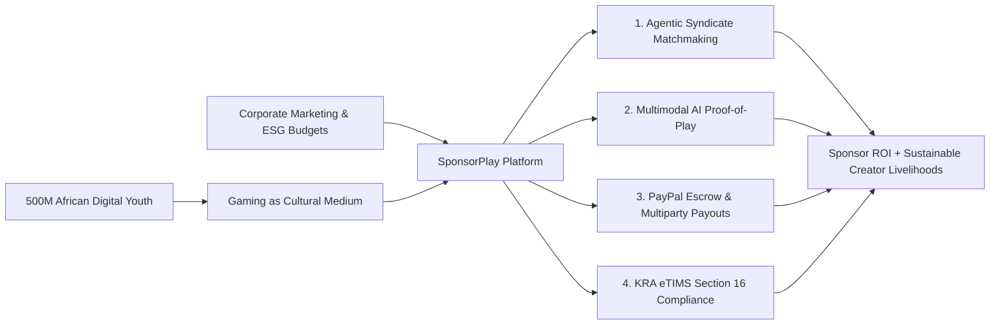
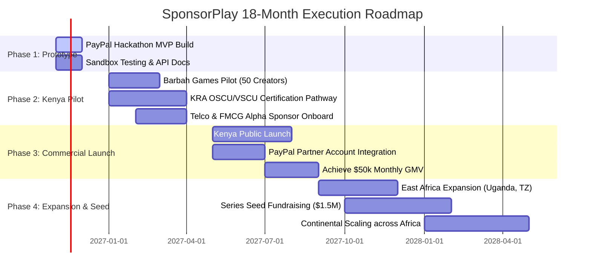

# SPONSORPLAY: Venture Strategy, Accelerator Investment Thesis & Startup Roadmap
**Document ID:** SP-STRAT-001  
**Project:** Barbah SponsorPlay (Kenya Esports & Creator Sponsorship Marketplace)  
**Track:** PayPal Global Hackathon - Sponsor Play  
**Author:** Solutions Architect & Systems Engineering Lead  

---

## 1. The Venture Thesis: The African Gaming & Creator Fintech Frontier

Africa is home to the youngest, fastest-growing population on the planet, with a median age of 19. Over the next decade, more than 500 million African youth will enter the digital economy equipped with smartphones, mobile internet, and gaming as their primary cultural medium.

In Kenya alone, the gaming and esports market is already valued between **$100 million and $137 million**, with telcos like Safaricom rolling out low-latency 5G and national gaming challenges. However, **95% of gaming talent, local tournament organizers, and campus gaming dens remain unmonetized and financially excluded**.

The barrier has never been consumer interest; it has been **commercial trust and regulatory friction**. Multinational and local corporate brands have millions in youth marketing budgets, but they cannot legally disburse funds to informal creators without violating **KRA eTIMS tax rules (Section 16)**, nor can they risk capital on unverified vanity metrics.

**SponsorPlay is not a simple directory. It is the programmatic financial and verification operating system for emerging market sponsorships.** By combining **Agentic AI (Multimodal Proof-of-Play)** with a **Dual-Rail Financial Engine (PayPal + KRA eTIMS)**, SponsorPlay creates an investable, high-margin, scalable fintech marketplace.



---

## 2. Business Model & Scalable Unit Economics

SponsorPlay operates a high-margin, asset-light marketplace model combining transaction take rates with enterprise B2B SaaS subscriptions.

```
+---------------------------------------------------------------------------------------------------------+
|                                      REVENUE ENGINE BREAKDOWN                                           |
+----------------------+---------------------------+------------------------------------------------------+
| Revenue Stream       | Pricing Mechanism         | Customer / Value Delivered                           |
+----------------------+---------------------------+------------------------------------------------------+
| Marketplace Take     | 8% to 12% commission on   | Deducted automatically from gross sponsorship budget |
| Rate                 | settled campaign escrow   | via PayPal Orders v2 payment_instruction             |
+----------------------+---------------------------+------------------------------------------------------+
| Corporate Brand      | $499 to $1,500 / month    | Unlimited AI matching, real-time live stream brand   |
| SaaS Tier            | annual subscription       | safety alerts, direct ERP eTIMS accounting sync      |
+----------------------+---------------------------+------------------------------------------------------+
| ESG & MetaTwin       | $250 per certified audit  | C-Suite ESG certification dossiers for corporate CSR |
| Certification Fee    | report                    | and youth employment regulatory reporting            |
+----------------------+---------------------------+------------------------------------------------------+
| Cross-Border FX /    | 1.0% to 1.5% margin on    | International brand USD-to-KES currency conversion   |
| Float Yield          | escrow settlement float   | and instant M-Pesa off-ramp routing                  |
+----------------------+---------------------------+------------------------------------------------------+
```

### 2.1 Unit Economics on a Representative $1,000 Campaign
* **Gross Merchandise Value (GMV):** $1,000.00 (KES 130,000).
* **Take Rate (10%):** $100.00.
* **Cost of Goods Sold (COGS):**
  - PayPal payment processing fee (~3.4% + $0.30): $34.30.
  - Multimodal AI inference (Gemini Vision + Whisper STT via batch processing): $3.50.
  - KRA eTIMS VSCU electronic signature API costs: $0.20.
  - Infrastructure & Cloud hosting (Render / Supabase / Cloudflare R2): $1.00.
* **Total Direct COGS:** $39.00.
* **Net Platform Contribution Margin:** **$61.00 (61.0% Net Margin on Platform Revenue)**.
* **Annual Repeat Rate:** Gaming brands sponsor recurring monthly or quarterly tournament circuits, resulting in high customer lifetime value (LTV) and negative net churn.

---

## 3. Market Size: TAM / SAM / SOM

```
+-------------------------------------------------------------------------------------------------------+
|                                    TOTAL ADDRESSABLE MARKET MATRIX                                    |
+---------------+---------------------+-----------------------------------------------------------------+
| Metric        | Value               | Geographic & Sector Scope                                       |
+---------------+---------------------+-----------------------------------------------------------------+
| TAM (Africa)  | $4.2 Billion        | Total Sub-Saharan Africa digital youth advertising, influencer   |
|               |                     | marketing, and corporate youth sponsorship by 2030.             |
+---------------+---------------------+-----------------------------------------------------------------+
| SAM (Kenya &  | $450 Million        | Gaming, esports, tech hardware, telecom, and youth brand        |
| East Africa)  |                     | activations across Kenya, Uganda, Tanzania, and Rwanda.         |
+---------------+---------------------+-----------------------------------------------------------------+
| SOM (Year 1-2 | $15 Million         | Grassroots esports tournaments, campus gaming clubs, and micro- |
| Focus)        | (Target 10% = $1.5M | gaming streamers in Nairobi, Eldoret, and Kenyan universities.  |
|               | Net Revenue)        |                                                                 |
+---------------+---------------------+-----------------------------------------------------------------+
```

---

## 4. Defensible Moat: Why Competitors Cannot Copy Us Overnight

1. **The Regulatory & Tax Engine Moat (KRA eTIMS & BII):** Global platforms (like Streamlabs, Twitch, or Patreon) do not integrate with KRA eTIMS. Without localized Section 16 compliance, no Kenyan corporate brand can legally use them for marketing budgets. SponsorPlay's certified integration forms a deep regulatory moat.
2. **The Multimodal Proof-of-Play Dataset:** African gaming streams feature unique linguistic blends of Swahili, English, and Sheng (Nairobi youth slang). Off-the-shelf American moderation tools fail to interpret local banter, accents, and context. Our fine-tuned audio-visual models provide unmatched verification accuracy.
3. **The Barbah PlayEconomy Network Flywheel:** SponsorPlay is not an isolated point solution; it integrates with Barbah Games' broader ecosystem:
   - **Coach2Earn:** Top sponsored players hire coaches to elevate performance.
   - **ArenaPay:** Tournament prize pools flow seamlessly through the same verified rails.
   - **Play2Pro:** Verified sponsorship history builds an auditable "Gamer Resume" for global esports scouting.

---

## 5. The PayPal Synergy & Accelerator Investment Pitch

### 5.1 Why PayPal Ventures / Accelerator Will Love SponsorPlay
* **Expands PayPal's Emerging Market Foothold:** PayPal is historically viewed in East Africa as an export tool for freelancers selling to the US/Europe. SponsorPlay transforms PayPal into the **primary B2B and B2C commercial engine inside East Africa**, anchoring domestic corporate-to-creator commerce.
* **Showcases Enterprise API Depth:** SponsorPlay is not just a basic "Buy with PayPal" button. It utilizes the full power of:
  - `Orders v2` Multiparty processing with `payment_instruction.platform_fees`.
  - Secure milestone escrow holding mechanisms.
  - Automated `Payouts API` mass disbursement.
  - Real-time `Webhooks` for event-driven agent triggers.
* **Financial Inclusion for the Informal Economy:** Connects unbanked, grassroots African youth directly to formal global financial rails.
* **Instant M-Pesa Off-Ramp Synergy:** Builds upon the existing PayPal-M-Pesa corridor (via Equity Bank/Thunes), enabling creators to spend their hard-earned sponsorship income at local shops within minutes.

### 5.2 Pitch Outline for the Judges & Investors
* **Slide 1: The Problem:** Kenya has 10M young gamers and a $137M gaming sector, but grassroots creators are broke. Corporate brands want to sponsor them, but Section 16 tax penalties and vanity metric fraud block the money.
* **Slide 2: The Solution:** SponsorPlay – The first AI-powered verified sponsorship marketplace with automated KRA eTIMS tax compliance and PayPal milestone escrow.
* **Slide 3: The Innovation (Agentic AI):** A swarm of 6 autonomous agents that scout syndicates, draft contracts, visually verify live streams via computer vision, and trigger automated payouts.
* **Slide 4: The Financial Architecture:** PayPal Orders v2 multiparty platform split + KRA eTIMS BII automated tax receipts.
* **Slide 5: Live Demo:** A 90-second run-through of a brand brief turned into a funded campaign, verified via computer vision, and receipted with a real KRA QR code.
* **Slide 6: Business Model & Traction:** 10% take rate, 61% net platform margins, and partnership with Barbah Games' network of 1,000+ gamers.
* **Slide 7: The Ask:** Hackathon victory + entry into PayPal Ventures Accelerator to launch the commercial pilot across 50 Kenyan gaming lounges.

---

## 6. 18-Month Execution Roadmap: From Hackathon to Series Seed



---

## 7. The Winning 5-Minute Hackathon Demo Script

This script provides the exact sequence to present the SponsorPlay working prototype to the hackathon judges:

* **[0:00 - 0:45] The Hook & Empathy:**
  "Judges, imagine you are the marketing director of Safaricom or Red Bull. You want to sponsor local gaming youth. But if you give KES 100,000 to an unregistered gamer in Kayole via M-Pesa, KRA slaps you with a 30% tax penalty under Section 16 because there's no eTIMS invoice! And as a gamer, you spend 40 hours streaming, only for sponsors to ghost you. That ends today with SponsorPlay."
* **[0:45 - 1:45] The Brand Experience & Agent 1:**
  "Watch this live: The sponsor types a simple brief: *'We want to promote Safaricom 5G Home Internet to university gamers in Nairobi. Budget: $770 (KES 100,000)'*. In 3 seconds, Agent 1 evaluates our creator graph and bundles a **Sponsorship Syndicate**: 1 campus tournament organizer and 2 competitive EA FC streamers. It's not just follower counts; it's verified community density."
* **[1:45 - 2:45] PayPal Checkout & The Dual-Rail Engine:**
  "The brand clicks *Approve*. Behind the scenes, Agent 2 generates a milestone contract. Watch the screen: The brand opens PayPal Sandbox Checkout. Notice the transaction breakdown: The platform fee is split automatically via `Orders v2 payment_instruction`. Funds are safely locked in **PayPal Smart Escrow**."
* **[2:45 - 3:45] Autonomous Multimodal Proof-of-Play (Agent 3):**
  "Now, the tournament happens. The creator uploads the stream VOD. Look at Agent 3 in real-time: Computer vision detects the sponsor logo in the overlay, measures screen airtime at 8.4% (exceeding the 5% threshold), and Whisper STT transcribes the shoutcaster saying: *'Big up Safaricom 5G for powering today's LAN finals!'*. Confidence score: 96.2%. The Proof-of-Play certificate is sealed."
* **[3:45 - 4:30] KRA eTIMS Tax Invoicing & Automated Payout:**
  "Because the deliverable is verified, Agent 4 instantly generates an official KRA eTIMS invoice via Buyer-Initiated Invoicing (BII), complete with a scannable KRA QR code and 5% Withholding Tax deducted. The brand's expense is 100% tax deductible! Immediately, PayPal Payout releases the net cash to the creator's wallet, ready for instant cash-out to M-Pesa."
* **[4:30 - 5:00] The Vision:**
  "We are Barbah SponsorPlay. We don't just connect brands with gamers; we turn African gaming into verified skills, sustainable livelihoods, and tax-compliant global opportunities. Thank you!"
